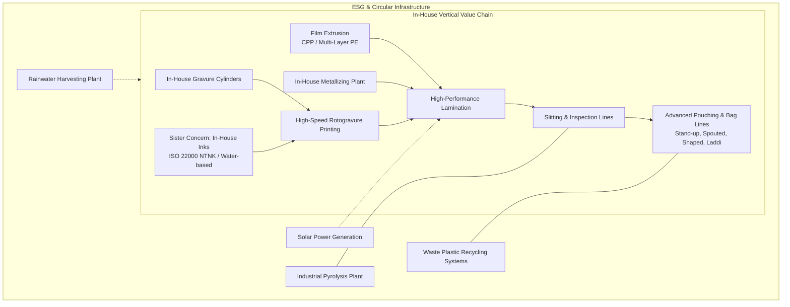
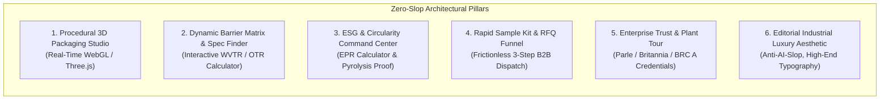

# Aditya Flexipack: Comprehensive Corporate Intelligence, Digital Audit & Competitive Supremacy Blueprint

---

## 1. Executive Summary & Corporate Dossier

**Aditya Flexipack Private Limited** is one of Northern India’s largest, highly integrated flexible packaging converters. Operating from an expansive **18-acre industrial campus** on the NH-2 Kolkata–Delhi national corridor in Kanpur Dehat, Uttar Pradesh, the company represents a rare combination of massive industrial scale (**~4,000 Metric Tons/month** laminate output) and deep vertical backward integration.

Despite manufacturing high-barrier packaging for India's foremost FMCG royalty—including **Parle Products**, **Britannia Industries**, and **ITC Limited**—and holding prestigious national honors, Aditya Flexipack’s current digital footprint severely understates its industrial magnitude and technological prowess.

```
+----------------------------------------------------------------------------------------------------+
|                                    ADITYA FLEXIPACK PVT. LTD.                                      |
+----------------------------------------------------------------------------------------------------+
|  • CIN: U21095UP2019PTC123405                       • Incorporation Date: 15 November 2019         |
|  • Authorized / Paid-up Capital: ₹15.00 Crore       • Plant Footprint: 18 Acres (NH-2 Corridor)    |
|  • Laminate Capacity: ~4,000 MT / Month             • Work Force: 500+ Engineers & Operators       |
|  • Key Promoters: Raman Tandon, Nitin Tandon        • Accreditations: BRCGS A Grade, ISO 22000     |
+----------------------------------------------------------------------------------------------------+
```

### Registered Corporate Address & Facilities
* **Plant & Head Office:** Gata No. 445 Kha, Rania, Fatehpur Roshnai, Kanpur Dehat, Uttar Pradesh – 209304, India.
* **Legacy Footprints & Operations:** Dada Nagar Industrial Area & Panki Industrial Estate, Kanpur.
* **Corporate Communication Channels:**
  * Primary Inquiries: `info@adityaflexipack.com`
  * Operations / Management: `adityaflex@adityaflexipack.com`
  * Direct Lines: `+91-9839084823`
  * Official Domain: `https://www.adityaflexipack.com/`

---

## 2. In-Depth Audit: Current Website (`adityaflexipack.com`) & Digital Footprint

### 2.1 The Current Website Analysis
An exhaustive assessment of the current web domain reveals critical shortcomings that decouple the company’s digital reality from its industrial capability:

```
[Current Web Experience: adityaflexipack.com]
┌────────────────────────────────────────────────────────────────────────┐
│ [Header]: Static logo, generic navigation (Home, About, Products, etc.)│
├────────────────────────────────────────────────────────────────────────┤
│ [Hero Section]: Low-res banner carousel, generic marketing statements  │
│                 "Welcome to Aditya Flexipack - Quality Solutions"      │
├────────────────────────────────────────────────────────────────────────┤
│ [Content Grid]: Static product bullet points (Laminates, Pouches, Inks)│
│                 Zero technical barrier specs, no WVTR/OTR metrics      │
├────────────────────────────────────────────────────────────────────────┤
│ [Proof Points]: Text mentions of Parle/Britannia awards without visual │
│                 validation or interactive client case studies          │
├────────────────────────────────────────────────────────────────────────┤
│ [Contact / CTA]: Static mailto: links and plain forms; no Sample Kit   │
│                  request, no instant RFQ, no interactive configurator  │
└────────────────────────────────────────────────────────────────────────┘
```

#### Key Technical & Aesthetic Deficiencies:
1. **The "Hidden Giant" Disconnect:** Visiting the current website gives the impression of a small regional converter rather than an enterprise packaging powerhouse with a 4,000 MT/month capacity and 18-acre infrastructure.
2. **No Interactive Packaging Visualization:** Flexible packaging is an intensely dimensional, physical, and tactile medium. The current site only features flat 2D raster photographs. Prospective brand managers cannot see how a shaped pouch behaves, inspect bottom gussets, or examine barrier foil finishes.
3. **Absence of Technical Barrier Data:** B2B procurement heads and packaging engineers at FMCG conglomerates require empirical barrier parameters (Water Vapor Transmission Rate - WVTR, Oxygen Transmission Rate - OTR, Dart Impact, Tensile Strength, Heat Seal Range). The current site provides only generalized qualitative claims.
4. **Under-leveraged Sustainability & Circularity (EPR):** Despite running an in-house **pyrolysis plant, closed-loop waste recycling, and solar generation**, these massive green differentiators are buried in plain text rather than highlighted with metrics (e.g., Tons of plastic diverted from landfills, MWh of solar power generated, EPR compliance pathways).
5. **High-Friction Conversion Funnel:** There is no self-serve sample kit order mechanism, no dynamic Request For Quote (RFQ) builder, and no substrate specification configurator.

### 2.2 External Digital Footprint & Search Presence
* **Google Search Index:** The domain ranks for brand terms ("Aditya Flexipack Kanpur"), but has negligible organic visibility for high-intent B2B search phrases like *"BRC A Grade flexible packaging converter India"*, *"sustainable mono-material PE pouches FMCG"*, or *"custom shaped retort pouches manufacturer"*.
* **LinkedIn Presence:** No fully verified corporate LinkedIn pipeline or thought-leadership channel for their technical leadership, creating a vacuum where competitors actively capture procurement officers and packaging design heads.
* **B2B Directory Exposure:** Presence on IndiaMART, FalconeBiz, and IIA Online is largely uncurated and outdated, failing to channel high-value tier-1 corporate accounts.

---

## 3. Core Manufacturing Infrastructure: The Unfair Advantages

To surpass competitors, the new platform must spotlight Aditya Flexipack’s integrated capabilities that most converters lack:



### 1. In-House Gravure Cylinder Making
* Eliminates reliance on external cylinder engravers (such as third-party pre-press houses).
* Enables ultra-fast turnaround times for new SKUs, cylinder proofs, and promotional design revisions for brands running aggressive marketing campaigns.

### 2. Dedicated In-House Ink Formulation (ISO 22000 Certified)
* Operating a sister manufacturing unit specializing in printing inks for food packaging:
  * **Polyurethane (PU) Inks**
  * **NTNK Inks (Non-Toluene, Non-Ketone)** ensuring compliance with international food contact regulations (Nestlé guidelines, EU regulations).
  * **ARSR Inks (Alcohol Resistant & Solvent Resistant)** for harsh chemicals, sanitizers, and detergents.
  * **Water-Based Inks** for eco-friendly and paper-based structures.

### 3. Integrated Film Processing & Metallizing
* In-house Cast Polypropylene (CPP) and Polyethylene (PE) blown-film extrusion lines.
* In-house vacuum metallizing capability, delivering precision barrier coatings against gas, moisture, and aroma migration without external vendor markup.

### 4. Eco-Industrial Circularity (Pyrolysis & Green Energy)
* **Pyrolysis Plant:** Thermal conversion of post-production polymer waste into fuel oil, establishing near-zero industrial landfill contribution.
* **Solar Energy Integration:** Large-scale rooftop solar panel installation powering production lines with renewable megawatts.
* **Rainwater Harvesting:** Comprehensive water replenishment system across the 18-acre campus.

---

## 4. Client Pedigree & Institutional Trust Signals

Aditya Flexipack’s track record includes long-term supplier relationships with India’s most demanding FMCG conglomerates. These credentials form the bedrock of immediate enterprise conversion:

```
┌───────────────────────────────────────────────────────────────────────────────────────────────┐
│                                   ENTERPRISE HALL OF FAME                                     │
├───────────────────────────────┬───────────────────────────────┬───────────────────────────────┤
│        PARLE PRODUCTS         │     BRITANNIA INDUSTRIES      │          ITC LIMITED          │
│   2-Time Gold Winner Award    │   COVID-19 Best Partner Award │ Innovation & Contribution Awd │
│ High-speed biscuit wrappers & │ Seamless emergency supply of  │ Custom barrier structures for │
│ primary secondary polybags    │ staple food packaging         │ FMCG foods & confectionery    │
├───────────────────────────────┴───────────────────────────────┴───────────────────────────────┤
│                                  HONORS FROM HEADS OF STATE                                   │
│  • Conferred National Entrepreneurship Accreditations by Former President Dr. A.P.J. Abdul Kalam │
│  • Conferred National Business Recognition by Former President Smt. Pratibha Patil             │
│  • State Export Excellence Accolades from the Government of Uttar Pradesh                      │
└───────────────────────────────────────────────────────────────────────────────────────────────┘
```

---

## 5. Competitor Intelligence & Digital Benchmark Matrix

We audited the major players in India's flexible packaging landscape to dissect their strengths, digital strategies, and clear vulnerabilities:

| Evaluation Dimension | **UFlex Limited** (`uflexltd.com`) | **Paharpur 3P** (`paharpur3p.com`) | **Huhtamaki India** (`huhtamaki.com`) | **TCPL Packaging** (`tcpl.in`) | **Aditya Flexipack** *(Current)* |
| :--- | :--- | :--- | :--- | :--- | :--- |
| **Market Positioning** | Global MNC conglomerate, high-volume multinational supplier | Pouch specialist, liquid/retort packaging pioneer | European multinational leader in sustainable food packaging | Integrated carton & flexible packaging hybrid | Regional heavy-duty converter (uncommunicated scale) |
| **Digital UX / UI** | Corporate corporate-heavy, complex navigation with 6+ sub-divisions | Clean B2B product showcase with clear taxonomy | Global Scandinavian design system, corporate ESG focus | Polished investor-relations and corporate portal | Outdated 2010s brochure site, non-interactive |
| **Interactive Configurator** | Virtual showroom with 3D product previews | **"Build Your Packaging"** interactive finder tool | *blueloop™* sustainability material selector | Prepress & 3D proofing showcase (static) | **None** |
| **Technical Barrier Data** | High technical documentation across chemical & film divisions | Clear application guides for barrier films | Detailed technical compliance matrices (DMF, FDA, BRC) | Standard technical specs | Generic bullet points without quantitative metrics |
| **Circularity & ESG Hub** | **"Project Plastic Fix"** (4Rs narrative, MLP recycling) | Recyclable mono-PE / paper-based packaging showcase | Deep circular economy platform with life-cycle analysis | Mono-material laminate & recycled board disclosures | Brief textual mention of solar & pyrolysis |
| **Lead Generation Flow** | Traditional enterprise inquiry form | Structured packaging inquiry with format selection | Centralized international contact gateway | Standard sales contact form | Bare `mailto:` and unformatted contact page |

### Competitor Vulnerabilities We Can Exploit:
1. **The Bureaucratic Slowness of MNCs (UFlex / Huhtamaki):** Large packaging conglomerates have slow quote cycles, high minimum order quantities (MOQs), and impersonal customer interaction. Aditya Flexipack can position itself as the **agile tier-1 enterprise partner**—offering identical Fortune-500 scale with significantly faster speed-to-market.
2. **Fragmented Value Chains in Mid-Tier Converters (Paharpur / TCPL):** Many converters outsource their cylinders or inks, resulting in 2-3 week delays when a brand changes artwork. Aditya Flexipack’s **100% in-house ink + cylinder ecosystem** cuts lead times by half.
3. **Impersonal, Boring Web Experiences:** Competitor websites are either dry corporate directories or cookie-cutter template designs. None of them provide a fast, visually captivating, modern web-app experience with real-time 3D shaders, procedural material rendering, and instant spec generation.

---

## 6. Strategic Blueprint: How We Will Decisively Surpass Them

To establish Aditya Flexipack as the indisputable benchmark in flexible packaging, the new web platform will be built upon 6 architectural pillars:



### Pillar 1: Procedural 3D Packaging Studio (Interactive Three.js)
* **What it does:** Rather than static product photos, procurement managers and brand teams can interactively explore 3D packaging formats directly in the browser:
  * **Stand-Up Pouch with Zipper** (Dry fruits, snacks, confectionery)
  * **Spouted Shaped Pouch** (Liquid detergents, sauces, beverages)
  * **3-Side Seal Pillow Pack / Fin-Seal Wrap** (Biscuits, bars, pharma strips)
  * **Center-Seal Gusseted Bag** (Atta, pulses, tea, industrial powders)
* **Interactive Material Shader Engine:**
  * Toggle between **Metallized High-Barrier Foil**, **Soft-Touch Matte Finish**, **Kraft Paper Laminate**, and **Clear High-Barrier Window**.
  * Dynamic light reflections showing seal integrity, tear notches, and finish premiumness.

### Pillar 2: Dynamic Barrier Matrix & Substrate Configurator
* **What it does:** An engineering-grade selector where FMCG packaging developers select their constraints:
  * *Product Category:* (e.g., Nitrogen-flushed chips, Retort curry, Highly hygroscopic milk powder, Agrochemical liquid).
  * *Required Shelf Life:* (6 months, 12 months, 24 months).
  * *Circularity Target:* (Standard High-Barrier vs. 100% Recyclable Mono-PE Structure).
* **Output:** Instantly renders the cross-section substrate diagram (e.g., `12µ PET / 12µ Met-PET / 50µ Natural PE`), displays anticipated WVTR & OTR barrier protection curves, and allows one-click sample requesting for that exact structure.

### Pillar 3: Circularity, EPR Compliance & ESG Dashboard
* **What it does:** In response to India’s stringent Plastic Waste Management Rules (PWM) and Extended Producer Responsibility (EPR) mandates, this section acts as an advisory tool for brand managers:
  * **Mono-Material Readiness Tracker:** How Aditya Flexipack replaces complex multi-polymer non-recyclable structures with recyclable PE/PE or PP/PP mono-material laminates.
  * **Industrial Green Metrics:** Live visual telemetry showcasing the **Pyrolysis closed-loop**, **Solar MWh generated**, and zero liquid discharge policies.

### Pillar 4: Frictionless B2B Sample Kit & 24-Hour RFQ Engine
* **The Problem:** In packaging, brand managers will not order without touching and testing physical samples on their Form-Fill-Seal (FFS) machines.
* **Our Solution:** A dedicated **"Request Curated Sample Kit"** flow:
  1. Select industry (Food, Pharma, Home Care, Agrochemicals).
  2. Choose format (Laminate rolls, Pouches, Spouts).
  3. Enter company email & plant address -> Instant dispatch tracking generation.

### Pillar 5: Enterprise Trust Architecture
* Dedicated interactive case studies detailing how Aditya Flexipack supported **Parle** across millions of wrappers per day (2-Time Gold Award).
* The pandemic resilience story of **Britannia Industries** (Certificate of Appreciation).
* Live interactive credentials drawer: Downloadable BRCGS A Grade certificates, ISO 22000:2018 ink certificates, US FDA migration compliance reports, and audit-ready test reports.

### Pillar 6: Editorial "Zero-Slop" Industrial Aesthetic
* Elimination of generic blue-purple SaaS gradients, centered floating card clichés, and canned stock imagery.
* Implementation of a bespoke **tactile industrial aesthetic**:
  * Precision technical typography (e.g., high-character sans with monospace tabular numerals for engineering specs).
  * Dark graphite and warm metallic accents reflecting raw packaging materials (aluminum, polymer, ink pigment).
  * Real manufacturing micro-details: rotogravure cylinder meshes, extrusion die precision, and micro-perforations.

---

## 7. Recommended Sitemap & Content Architecture

```
Aditya Flexipack (Next.js App Router Architecture)
├── / (Homepage: Hero 3D Packaging Studio, Plant Metrics, Client Hall of Fame)
├── /about (18-Acre Campus, Promoters Raman & Nitin Tandon, Legacy, Timeline)
├── /capabilities (In-House Cylinders, In-House Inks, Film Extrusion, Metallizing)
├── /products (Interactive Packaging Directory)
│   ├── /products/laminates (Barrier, Extrusion, Paper, Mono-Material)
│   ├── /products/pouches (Stand-up, Spouted, Shaped, Retort, Zipper)
│   ├── /products/films (CPP, Multi-layer PE, Metallized Films)
│   ├── /products/inks (ISO 22000 NTNK, PU, ARSR, Water-based)
│   └── /products/cylinders (Electronic Gravure Engraving)
├── /sustainability (EPR Solutions, Pyrolysis Plant, Solar Power, Circular Mono-PE)
├── /spec-finder (Interactive Substrate & Barrier Configurator)
├── /sample-kit (Curated FMCG Packaging Sample Request Funnel)
├── /contact (Plant Coordinates, Plant Visits, RFQ Routing, Logistics Hub)
└── /certifications (BRCGS A Grade, ISO 22000, Food Safety Compliance Hub)
```

---
*Report synthesized for Aditya Flexipack digital transformation. Ready for architectural and structural execution.*
