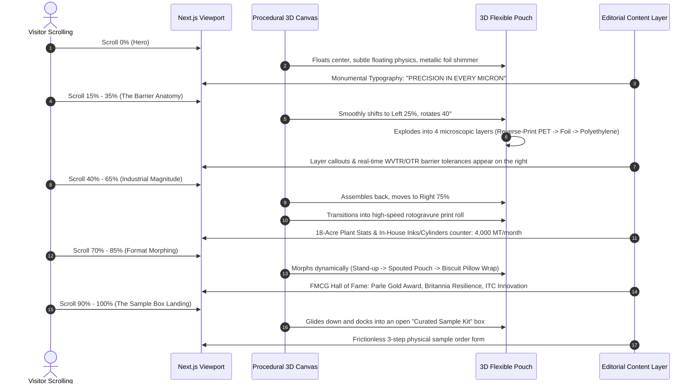

# Aditya Flexipack: 100x Creative & Spatial Interaction Blueprint
*Synthesizing Dribbble Award-Winning Packaging Concepts & Immersive Scroll Choreography (Inspired by Bliss Wedding)*

---

## 1. Creative North Star: "Tactile Industrial Luxury"

To build a website that delivers **100x creativity and zero AI slop**—a site that feels like a sensory, tactile, and cinematic experience rather than a typical corporate B2B template—we are establishing a new benchmark in industrial web design: **Tactile Industrial Luxury**.

### Key Inspirations Deconstructed:
1. **The Bliss Wedding Paradigm (`bliss-wedding.vercel.app`):**
   * **Why it captivates:** It treats the web page as an *editorial documentary* rather than a software dashboard. Pacing is deliberate; white space is cinematic; typography shifts between monumental elegance and microscopic technical precision; image and motion physics feel weighted and organic.
   * **Application to Aditya Flexipack:** Instead of a generic B2B manufacturer site, Aditya Flexipack becomes a **high-precision engineering house**. Every micron of barrier film, every rotogravure cylinder tooth, and every sealed pouch is presented with the reverence of luxury watchmaking or aerospace engineering.

2. **Dribbble's Top Packaging Concepts:**
   * **Spatial Continuity (The "Floating & Shifting Package"):** The product is not stuck in a gallery. A single physical packaging unit travels *with* the user through the scroll narrative, morphing, rotating, exploding into layer cross-sections, and docking into technical diagrams.
   * **Material Tactility:** Recreating realistic physical properties—metallized foil reflections, matte paper grain, gloss highlights, tear notches, and airtight zipper seals—via real-time WebGL shaders.

```
┌────────────────────────────────────────────────────────────────────────────────────────┐
│                        THE SPATIAL SCROLL JOURNEY (HERO TO DOCK)                       │
├───────────────────┬───────────────────┬───────────────────┬────────────────────────────┤
│   STAGE 1: HERO   │  STAGE 2: ANATOMY │ STAGE 3: SCALE    │  STAGE 4: DOCK & SAMPLE    │
│ [Floating Pouch]  │ [Exploded Layers] │ [Cylinder Orbit]  │ [Lands in Sample Box]      │
│ Center stage with │ Shifts left;      │ Shrinks & orbits  │ Drops smoothly into a 3D   │
│ cursor-reactive   │ 4 barrier layers  │ high-speed press  │ dispatch box; one-click    │
│ metallic sheen    │ peel apart in 3D  │ showing 4k MT/mo  │ sample order triggered     │
└───────────────────┴───────────────────┴───────────────────┴────────────────────────────┘
```

---

## 2. The Signature Feature: The "Scroll-Tied Spatial Package" Choreography

The core visual hook is a **persistent procedural 3D flexible pouch** (built with Three.js / React Three Fiber) pinned to the viewport, whose position, rotation, scale, and material shader are driven seamlessly by scroll progress:



### Technical Implementation Mechanics:
* **Zero Performance Lag:** Instead of heavy 50MB GLTF meshes, we construct lightweight procedural Three.js geometries using Bezier curves for pouch folds, hermetic side seals, and spouts.
* **Custom PBR Shaders:** Realistic normal maps mimicking polymer micro-creases, diffuse light bouncing off aluminum foil, and soft-touch matte lamination.
* **Smooth Inertial Damping:** Integrated with Lenis smooth-scrolling to ensure that fast flick-scrolling or slow trackpad nudges translate into liquid-smooth physics.

---

## 3. Brand Identity & Tailored Color Palette

Taking cues from Aditya Flexipack's corporate identity and elevating it into an **editorial industrial palette**:

```
+--------------------------------------------------------------------------------------------------+
|                                    ADITYA FLEXIPACK COLOR DNA                                    |
+--------------------------------------------------------------------------------------------------+
|  [ Deep Obsidian ]      [ Precision Indigo ]    [ Signal Crimson ]    [ Liquid Platinum ]        |
|  #090D14                #1D4ED8                 #E11D48               #F1F5F9                    |
|  Technical foundation   Heritage corporate      Trust accent &        Foil sheen &               |
|  and depth              primary blue            award highlight       clean-room contrast        |
+--------------------------------------------------------------------------------------------------+
```

### Color Token Architecture:
1. **The Foundry Dark Base (`#090D14` / `#0E1420`):**
   * Rich obsidian black with an undertone of midnight blue. Creates an atmosphere of prestige, industrial capability, and deep contrast.
2. **Aditya Heritage Precision Blue (`#1D4ED8` & `#3B82F6`):**
   * Modernizes the existing company logo blue. Used for active engineering markers, interactive toggle states, and mechanical highlights.
3. **Signal Crimson / Gold Seal (`#E11D48` & `#F59E0B`):**
   * Reserved strictly for the **Enterprise Proof Points**: Parle Gold Winner badge, Britannia COVID-19 Resilience medal, and BRCGS A Grade certification seal.
4. **Clean-Room Medical White & Liquid Platinum (`#FFFFFF`, `#F8FAFC`, `#E2E8F0`):**
   * Used for high-contrast typography, crisp product inspection trays, and barrier cross-section layers.
5. **Architectural Grid Lines (`rgba(255, 255, 255, 0.08)`):**
   * Sub-pixel structural grid borders inspired by packaging die-lines and CAD drafting blueprints.

---

## 4. Anti-AI-Slop Directives: Eliminating Every Generic B2B Trope

Following our configured **Hallmark** and **TasteSkill** standards, we reject the default formulas of ordinary AI-generated landing pages:

| The Generic AI Cliché (Forbidden) | The Aditya Flexipack Custom Innovation |
| :--- | :--- |
| **Centered hero** with soft purple/blue radial mesh gradient | **Asymmetric industrial architectural grid** with raw dark obsidian, real-time lighting, and procedural 3D tactile materials. |
| **Floating 3-column feature cards** with generic SVG icons | **Die-Cut Engineering Schematics** featuring technical drawing lines, dimension callouts (in mm/microns), and live barrier data meters. |
| **Canned marketing copy:** *"Transforming packaging with quality solutions"* | **Concrete, authoritative engineering statements:** *"4,000 MT Monthly Capacity. Sub-micron Gravure Precision. Zero Landfill Pyrolysis."* |
| **Stock photos of people in business suits** shaking hands | **Macro photography of machinery in action:** Laser-engraved copper cylinder grooves, solventless lamination rollers, blown film bubbles. |
| **Static "Contact Us" forms** with 10 generic input fields | **Interactive "Curated Sample Dispatcher" & "Barrier Matrix Finder"** that feels like an engineering workstation. |

---

## 5. Unique Interactive Features to Surpass Every Competitor

### Feature A: The "Die-Line Blueprint" Layer Inspector
* Brand packaging engineers can slide a horizontal scrub bar to see an **X-Ray view** of a laminate structure:
  * Layer 1: Reverse-printed 12µ Polyester (BOPET)
  * Layer 2: Solventless Polyurethane Adhesive
  * Layer 3: Ultra-high barrier 9µ Vacuum Metallized PET (or pure Aluminum Foil)
  * Layer 4: Food-Grade 50µ Cast Polypropylene (CPP) / Polyethylene (PE) sealant
* Each layer displays real-time performance indicators: **OTR** (Oxygen Transmission), **WVTR** (Moisture Protection), and **Dart Puncture Resistance**.

### Feature B: The "Finish & Surface" Tactile Switcher
* Directly inside the 3D studio, visitors can toggle physical surface finishes:
  1. **High Gloss Foil:** Bright specular light glint for snacks and confectionery.
  2. **Velvet Soft-Touch Matte:** Tactile, anti-reflective luxury finish for premium tea, coffee, and cosmetics.
  3. **Natural Kraft Paper Laminate:** Earthy textured feel for organic grains and sustainable lines.
  4. **Windowed Barrier:** Transparent window cutout allowing inspection of the product inside.

### Feature C: The 18-Acre Interactive Campus Fly-Through
* A mini CAD-style interactive bird's-eye map of the Kanpur plant:
  * Click `[Cylinder Engraving]` -> Shows electronic stylus cutting copper cells.
  * Click `[In-House Inks]` -> Shows the ISO 22000 NTNK ink formulation laboratory.
  * Click `[Pyrolysis Unit]` -> Shows the thermal recycling cycle turning scrap into clean fuel.
  * Click `[Solar Array]` -> Shows real-time renewable kilowatt generation counter.

### Feature D: "FMCG Proof Vault" (Parle, Britannia, ITC)
* Instead of ordinary client logos, each client has an interactive **Case Dossier**:
  * **Parle:** "How Aditya Flexipack prints and delivers 10+ million biscuit wrappers daily with zero defect tolerance (2-Time Gold Award Winner)."
  * **Britannia:** "Supply chain resilience: Maintaining uninterrupted food distribution during the 2020 national lockdown (Official Certificate of Appreciation)."
  * **ITC Limited:** "Pioneering new barrier structures for next-generation confectionery (Innovation & Contribution Award)."

---

## 6. Micro-Interactions & Motion Choreography

* **Magnetic Cursor Attractor:** Buttons and technical spec pills subtly pull toward the visitor's cursor within a 30px radius.
* **Foil Iridescence Effect:** As the cursor travels across cards or text headings, a subtle holographic rainbow sheen reflects along the typography contours.
* **Fluid Audio Feedback (Optional / Haptic Cue):** A subtle, satisfying sub-bass click when switching packaging formats or snapping layers together in the inspector.
* **Tactile Spring Physics:** Modals and drawers open with zero bounce-cliché; instead, they have the solid, hydraulic damping of heavy industrial machinery opening.

---
*Ready for user alignment before commencing system architecture and code.*
